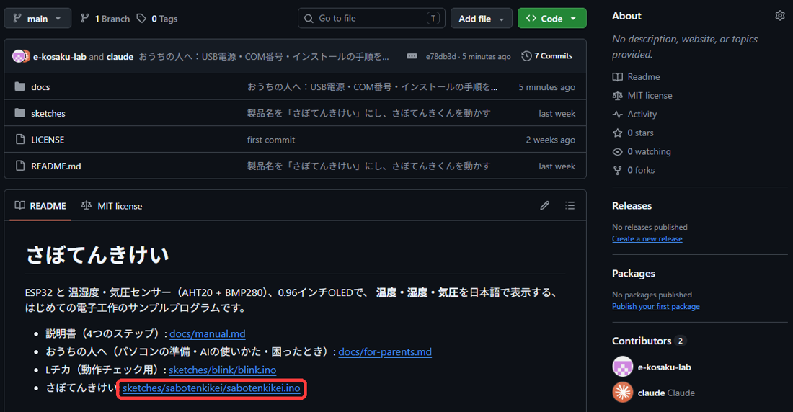
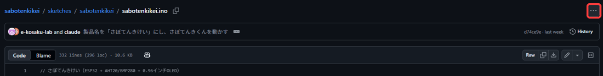
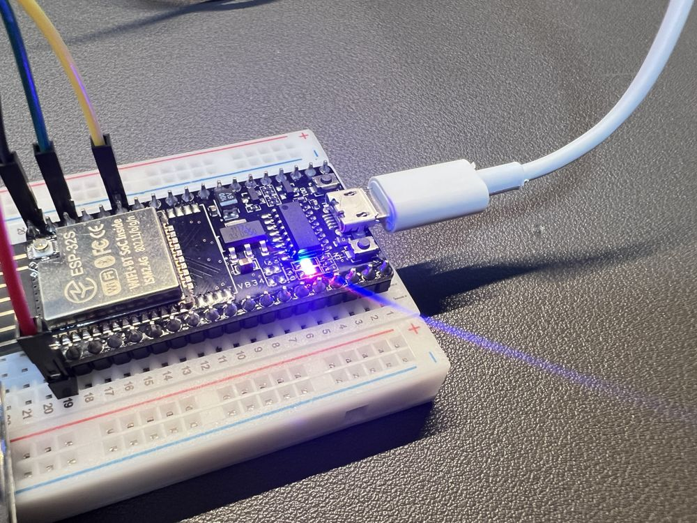

# おうちの人へ

このページは、おうちの人向けです。お子さま向けの本編は [説明書](manual.md) にあります。

## はじめに

- **おうちの人も、はじめてで大丈夫です。** 先生役ではなく、いっしょに試して、いっしょに悩む「なかま」として付き合ってください。
- うまくいかない時間も、このキットの体験の一部です。すぐに答えを教えず、「どこがちがうと思う？」と聞いてみてください。
- 専門用語は、なるべく使わずに書いています。どうしても出てくる言葉は、下の「ことば」で説明しています。

## だれが、何をするか

| ステップ | お子さま | おうちの人 |
|---|---|---|
| 1. 光った！ | 部品をさす・線をつなぐ・たしかめる | 小さな部品の扱いを見守る。電気は、パソコンのほか、スマホ用のUSB電源（USB充電器・モバイルバッテリー）からもらえます |
| 2. 変えてみよう | 数字・言葉・0と1の絵を書きかえる | **パソコンの準備**（このページの「パソコンの準備」）と、書き込みの操作の手伝い |
| 3. AIにお願い | やりたいことを考える・画面でたしかめる | **AIの操作**（このページの「AIを使うとき」） |
| 4. じぶんで考える | アイデアを考えて作る | 話を聞く。必要ならステップ2・3のやりかたで手伝う |

## ことば

| ことば | 意味 |
|---|---|
| ESP32（イーエスピー32） | 小さなコンピューターの部品。このキットの頭脳 |
| プログラム（スケッチ） | ボードへの命令を書いた文章。ファイル名の最後が `.ino` |
| 書き込み | パソコンで書いたプログラムを、ボードに送ること |
| Arduino IDE（アルドゥイーノ アイディーイー） | プログラムを書いて、書き込むための無料のソフト |
| ライブラリ | 画面やセンサーを使うための、出来合いの部品のようなプログラム |
| ポート | パソコンがボードを見つけたときの「つなぎ口」の名前（Windowsでは「COM」と数字。たとえば COM3 や COM5。番号は、パソコンやさす口によってちがいます） |
| VCC・VDD、SCL・SCK など | 部品によって、同じはたらきの足の名前がちがうことがあります。説明書の「部品の足の名前が、ちがうとき」を見てください |
| SPI（エスピーアイ） | I2C（このキットで使う、4本の線でつなぐ方式）とは別の通信の方式。MOSI・MISO・SCK・CS の4本を使う。今回は使わない。MOSI は SDI、MISO は SDO と書かれることもある |

---

<a id="pc"></a>
## パソコンの準備（ステップ2の前に・1回だけ）

目安: 30分〜1時間（インターネットの速さによります）。

### 用意するもの

- パソコン（Windows または Mac）【要確認】Chromebook は Arduino IDE が使えないため対象外と書くか
- インターネット
- USBの差し込み口がない場合は、変換アダプター

### 1. Arduino IDE を入れる

1. ブラウザで Arduino の公式サイトを開く: https://www.arduino.cc/en/software
2. 「Arduino IDE 2.x」を、お使いのパソコン（Windows / Mac）に合わせて、「DOWNLOAD」からダウンロードする。
3. ダウンロードしたファイル（たとえば `arduino-ide_2.3.11_Windows_64bit.exe`）をクリックして、画面の案内にしたがって、「はい」や「インストール」を選ぶ。（バージョンの数字は、ちがうことがあります）
4. 起動できたら、次へ進む。

### 2. ESP32 を使えるようにする

1. メニューの「ファイル」→「基本設定」（Macは「Arduino IDE」→「設定」）を開く。
2. 「追加のボードマネージャのURL」に、次の1行を入れて OK を押す。
   ```
   https://espressif.github.io/arduino-esp32/package_esp32_index.json
   ```
3. 左の「ボードマネージャ」（ボードの絵のアイコン）を開き、「esp32」と検索する。
4. 「esp32 by Espressif Systems」の「インストール」を押す。（少し時間がかかります）
5. メニューの「ツール」→「ボード」→「esp32」→ **「ESP32 Dev Module」** を選ぶ。

### 3. ライブラリを入れる

1. 左の「ライブラリマネージャ」（本の絵のアイコン）を開く。
2. 「U8g2」と検索して、**olikraus** さんのものを「インストール」。
3. 「Adafruit BMP280」と検索して「インストール」。
   「ほかに必要なライブラリも入れますか？」と聞かれたら、**「すべてインストール」**。

### 4. パソコンとボードをつなぐ

1. ボードを、付属の **USBケーブル** でパソコンにつなぐ。
2. 「ツール」→「ポート」で、ボードのポートを選ぶ。
   - Windows: 「COM3」「COM5」など、「COM」と数字の名前（番号は、パソコンによってちがいます）
   - Mac: 「/dev/cu.usbserial-…」などの名前
3. ポートが出ないときは、下の「うまくいかないとき」を見てください。

### 5. 書き込みのやりかた（ステップ2から毎回）

1. `sabotenkikei.ino` を開く。<https://github.com/e-kosaku-lab/sabotenkikei/blob/main/sketches/sabotenkikei/sabotenkikei.ino>
   - GitHubのページの下のほうに、「さぼてんきけい: sketches/sabotenkikei/sabotenkikei.ino」と書いてあります。その青い文字（リンク）をクリックします。

     

   - 開いたページの、右はしの「…」（3つの点のマーク）をクリックして、「Download」を選びます。プログラム（スケッチ）が、ダウンロードされます。

     

   - ダウンロードしたファイルをダブルクリックすると、Arduino IDE（ソフト）が起動します。起動しないときは、Arduino IDE の「ファイル」→「開く」で開きます。
   - 「スケッチ用のフォルダを作りますか？」と聞かれたら「OK」。
2. 「ツール」→「ボード」が「ESP32 Dev Module」、「ポート」が選ばれていることを確認。
3. 画面の左上の **→（書き込み）ボタン** を押す。
4. 下の黒い画面に「Connecting……」と出たまま進まないときは、ボードの **BOOT ボタン** を、「Writing」と出るまで押し続ける。
5. 「Hard resetting」などと出て止まったら完了。数秒で画面が切りかわります。

> **元にもどしたいとき:** もう一度 `sabotenkikei.ino` をダウンロードして書き込めば、出荷したときと同じ表示にもどります。
> 書きかえたものを残したいときは、「ファイル」→「名前を付けて保存」で別の名前にしておくと安心です。

---

<a id="ai"></a>
### 6. ほかのプログラムを書いてみよう：Lチカ（新しいスケッチから）

ステップ2の「かえてみよう！」に慣れたら、ボードの小さな青いLEDを光らせる、みじかいプログラム「Lチカ」を、**自分で書き写して**、書き込んでみましょう。ワイヤーは、つながなくてだいじょうぶです（ボードとUSBケーブルだけ）。

> **先に読んでください:** Lチカを書き込むと、ボードに入っている「さぼてんきけい」のプログラムは、いったん消えます。あとで、上の「書き込みのやりかた」で、`sabotenkikei.ino` を書き込めば、もとにもどります。

1. ボードを、USBケーブルで、パソコンにつなぐ。
2. Arduino IDE で、「ファイル」→「新規スケッチ」を選ぶ。
3. 画面に、はじめから書いてある文字（`void setup() { … }` と `void loop() { … }`）を、**ぜんぶ消す**。
4. 下のプログラムを、コピーして、貼り付ける（または、自分で書き写す）。

```cpp
// Lチカ（動作チェック用）：ボードの青いLEDを、1秒ごとに、ついたり消えたりさせます
const int LED_PIN = 2;  // 青いLEDは、2番のピンにつながっています

void setup() {
  pinMode(LED_PIN, OUTPUT);
}

void loop() {
  digitalWrite(LED_PIN, HIGH);  // LEDをつける
  delay(1000);                  // 1000 = 1秒まつ
  digitalWrite(LED_PIN, LOW);   // LEDを消す
  delay(1000);                  // 1000 = 1秒まつ
}
```

5. 「ツール」の「ボード」が「ESP32 Dev Module」、「ポート」が選ばれていることを確かめる。
6. 左上の **→（書き込み）ボタン** を押す。「保存しますか？」と聞かれたら、名前を「blink」にして、保存する。
7. 下の黒い画面に「Connecting……」と出たまま進まないときは、ボードの **BOOT ボタン** を、「Writing」と出るまで押し続ける。
8. 書き込みが終わると、**ボードの小さな青いLEDが、1秒ごとに、ついたり消えたりします。**（赤いLEDは、電気が来ているしるしで、ずっとついています）



点滅したら、せいこうです！ パソコンとボードの準備は、できています。青いLEDが光らなくても、書き込みが「Hard resetting」で終わっていれば、書き込み自体は、できています。ボードの電源の赤いLEDは、プログラムとは関係なく、ついています。このプログラムは、[GitHub](https://github.com/e-kosaku-lab/sabotenkikei/blob/main/sketches/blink/blink.ino) にも置いてあります。

#### 数字をかえてみよう

プログラムの中の、`delay(1000);` の数字を、かえて、もう一度、書き込んでみよう。

- `1000` を `200` にすると、はやく点滅します。`3000` にすると、ゆっくりです。
- ついている時間と、消えている時間を、べつべつの数字にしてみよう。
- かえたら、書き込みのたびに、「どうなったか」を、ノートに書いておこう。

## AIを使うとき（ステップ3）

### ルール

- **AIはおうちの人が、おうちの人のアカウントで操作してください。** お子さまは「何をたのむか」を考え、結果を画面でたしかめる役です。
- AIのサービスには、**利用できる年齢の条件** があります。2026年11月に、各社の公式ページで確認した内容です。変わることがあるので、使う前に、各社のページでも確認してください。
  - ChatGPT（OpenAI）: 13歳以上。18歳未満は、親権者などの許可が必要。
  - Claude（Anthropic）: 18歳以上。
  - Gemini（Google）: 個人のGoogleアカウントは13歳以上（国によって、ちがうことがあります）。
  - どのサービスでも、小学生が自分のアカウントで使うことはできません。おうちの人のアカウントで、おうちの人が操作してください。
- 名前・住所・学校名・顔写真など、**個人の情報は入力しないでください。** プログラムだけを貼り付ければ十分です。
- AIの答えは、まちがっていることがあります。**動かしてたしかめるまでは、正しいとは限らない**、という姿勢を見せてあげてください。おうちの人がAIを使い、確かめる姿を見ること自体が、お子さまの学びになります。

### たのみかた

本編の「ステップ3」にある書き方（プログラムぜんぶ＋やりたいこと）をそのまま使えます。
うまく動かないときは、エラーの赤い文字や、画面のようすをそのまま伝えると、直してもらいやすくなります。

### よくあるつまずき

| ようす | ありそうな原因 |
|---|---|
| 書き込みのときに赤い文字が出る | AIの答えの一部だけ貼った・余計な説明文まで貼った。プログラムの部分だけを、全部入れかえる |
| 日本語が「□」や記号になる | その字が、画面の文字の一覧（フォント）に入っていない。ひらがな・カタカナにするか、AIに「U8g2の u8g2_font_b12_t_japanese2 に入っている字だけで」と伝える |
| Wi-Fi を使うプログラムが出てきた | 技適マークのないボードなので、**書き込まないでください**。「Wi-Fi・Bluetoothを使わずに」と付け加えてたのみなおす |

---

<a id="trouble"></a>
## うまくいかないとき

### ポートが出ない・書き込めない

1. **USBケーブルが「充電だけ」のものではないか。** 付属のケーブルは通信できますが、ほかのケーブルに替えたときは、通信できるケーブルか確認する。
2. ボードに明かりがつくか。つかないときは、USBのさしこみをやりなおす。
3. 別のUSB差し込み口で試す。
4. ドライバー（パソコンがボードを見つけるためのソフト）を入れる。このキットのボードは「CP2102」というチップを使っている想定です。
   - ダウンロード: https://www.silabs.com/developer-tools/usb-to-uart-bridge-vcp-drivers
   - 入れたあと、パソコンを再起動する。
5. 書き込み中に「Connecting……」で止まったら、BOOTボタンを押しながらもう一度書き込む。

【要確認】ドライバーのURLが今も正しいか。ボードのチップが本当にCP2102か（届いた実物で確認）。

### ライブラリが見つからない（赤い文字で「No such file」と出る）

- 「パソコンの準備」の 3 のライブラリ（U8g2、Adafruit BMP280）が入っているか確認する。

### 気圧が「---」になる

- 気圧センサーのアドレス（0x76 / 0x77）は、プログラム側で両方試しています。それでも出ない場合は、配線かセンサーの不良の可能性が高いです。線を差しなおしても直らなければ、ご連絡ください。

### 書きかえたら、画面が真っ暗になった

- プログラムの書きかえで、どこかが動かなくなっている可能性があります。「元にもどしたいとき」の方法で、出荷時のプログラムを書き込んでください。部品はこわれていません。

---

## つぎの一歩

お子さまが「もっとやりたい」と言ったら、道具や本、オンライン教室などの情報を、Webの「つぎの一歩」のページにまとめています。
https://e-kosaku-lab.github.io/

## お問い合わせ

- 購入したメルカリの取引メッセージでご連絡ください。
