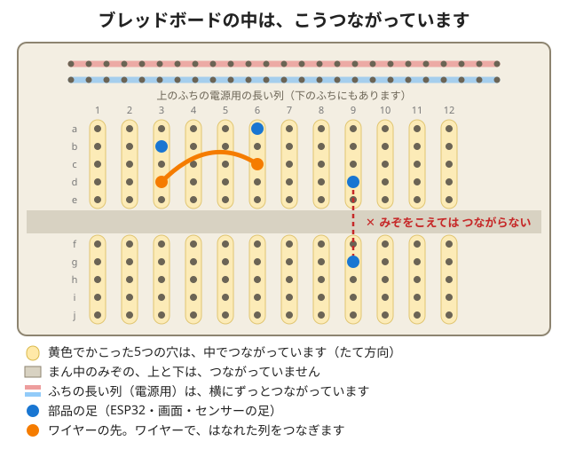

# さぼてんきけい 説明書（下書き）

> **準備中の説明書です:** 部品を使った実機での確認が済んでいない箇所は、【要確認】と書いています。
> 特に「配線の穴の位置」は、確認できしだい、写真つきで直します。

このキットで、**温度・湿度・気圧**を小さな画面に出す「さぼてんきけい」を作ります。
はんだ付けはいりません。おうちの人といっしょに、ゆっくり進めてください。

**おうちの人へ:** パソコンの準備や、うまくいかないときの直し方は、
[おうちの人へのページ](for-parents.md) にまとめました。先に一度、目を通してください。

## このキットの進めかた（4つのステップ）

| ステップ | すること | パソコン | 目安の時間 |
|---|---|---|---|
| **1. 光った！** | ワイヤーをつないで、USBをさす。画面に温度が出る | 電気をもらうだけ | 30分〜1時間 |
| **2. 変えてみよう** | 数字 → 言葉 → 0と1の絵 を、じぶんで書きかえる | おうちの人が準備 | 1〜2時間 |
| **3. AIにお願い** | 「こうしたい」を考えて、おうちの人がAIにたのむ。画面でたしかめる | おうちの人が操作 | 30分〜 |
| **4. じぶんで考える** | 新しい表示や遊びを考えて、作ってみる | いっしょに | すきなだけ |

1日で全部やらなくてだいじょうぶです。ステップ1だけで、その日はおしまいでもOKです。

## 0. 先に読んでください（おうちの人といっしょに）

- 対象年齢の目安は小学3年生以上です。おうちの人といっしょにお使いください。
- 小さな部品があります。小さなお子さまが口に入れないよう気をつけてください。
- 使う電気は、USBからの小さな電気だけです。家のコンセントに直接つなぐ部品はありません。
- **AIはおうちの人が操作してください。** AIのサービスには、使える年齢の条件があります（[おうちの人へのページ](for-parents.md#ai) を参照）。
- **電波法・技適について:** このキットのESP32ボードには技適マークがありません。付属のプログラムは Wi-Fi・Bluetooth を使いません。日本国内で、技適のないボードのWi-Fi・Bluetoothを使うと電波法違反になるおそれがあります。無線を使うプログラムを書くときは、ご自身で法令を確認してください。
- 動作確認は出荷前に行っていますが、市販品のような保証・修理はできません。

---

# ステップ1　光った！

ボードには、もう「さぼてんきけい」のプログラムが入っています。
**ワイヤーをつないで、USBをさすだけ** で、画面に温度が出ます。

## 1-1. 入っているもの（チェックしよう）

| 部品 | 数 | チェック |
|---|---|---|
| ESP32 ボード（NodeMCU-32S）… 小さなコンピューター | 1 | □ |
| センサー（AHT20 + BMP280）… 温度・湿度・気圧をはかる | 1 | □ |
| 画面（0.96インチ OLED） | 1 | □ |
| ブレッドボード … 穴がたくさんある板 | 1 | □ |
| ジャンパーワイヤー（10cm）… 部品どうしをつなぐ、細い電線。これから「ワイヤー」と呼びます | 10 | □ |
| USBケーブル | 1 | □ |

【写真を入れる】部品を並べた写真（名前を書き込む）

## 1-2. 部品をさす（配線）

> **USBケーブルは、まだささないでね。** 電気が来ていない状態で作ります。

### つなぐワイヤー（4本ずつ）

画面とセンサーは、**同じ4本のワイヤー**を、2つで分け合ってつなぎます。
（ワイヤー ＝ ジャンパーワイヤー。部品どうしをつなぐ、細い電線のことです）

| はたらき | ESP32ボードのピン | 画面 | センサー |
|---|---|---|---|
| 電気（+） | **3V3**（3.3V） | VCC | VCC |
| 電気（−） | **GND** | GND | GND |
| データ | **D21**（GPIO21） | SDA | SDA |
| 時計 | **D22**（GPIO22） | SCL | SCL |

- 電気（+）のワイヤーは、かならず「**3V3**」につなぎます。「5V」や「VIN」には、つながないでね（ESP32ボードのピンのことです）。
- 「3V3」は、**3.3ボルト（V）** の電気が出るピンです。「5V」は5ボルトで、部品によっては、こわれてしまうことがあります。
- ワイヤーの色は、どれでもだいじょうぶです。**同じはたらきのワイヤーは、同じ色にそろえる**と、まちがえにくくなります。
- 部品の足の名前（VCC、GND、SDA、SCL）は、基板に小さく書いてあります。虫めがねがあると見やすいよ。

### 部品の足の名前が、ちがうとき

部品によって、同じはたらきの足に、ちがう名前がついていることがあります。よく見る名前は、こうです。

| はたらき | この説明書の名前 | ほかによくある名前 |
|---|---|---|
| 電気（+） | VCC | VDD、VIN、3V3 |
| 電気（−） | GND | VSS |
| データ | SDA | SDI |
| 時計 | SCL | SCK |

- 迷ったら、部品の商品ページや、基板の説明で、**はたらき**を確かめよう。
- 部品についている「VIN」は、**電気（+）の入り口**です。ESP32ボードの「VIN」は、別のもの（5Vの電気）なので、つながないでね。

【要確認】今回のセンサーと画面の足の名前（VDD・SCK など）は、実物で確かめて、ここに書く。

### ブレッドボードの中のようす

ブレッドボードは、穴の下で、金属の板が穴どうしをつないでいます。見えないけれど、こんなふうにつながっています。



- **たて5つの穴は、つながっています。** 同じ列にさしたものは、電気がつながります。
- **まん中のみぞの上と下は、つながっていません。** ESP32のように足が2列あるボードは、みぞをまたいでさします。こうすると、左右の足が、べつべつの列になります。
- **ふちの長い列は、横にずっとつながっています。** 電気（+）や電気（−）を、みんなで使うときに便利です。
- **ワイヤーは、はなれた列どうしをつなぐ**ために使います。

### ブレッドボードにさす

1. ESP32ボードを、ブレッドボードの **真ん中のみぞをまたぐように** さす。
   （ボードが大きいので、さしたあとに使える穴は、ボードの外がわの列だけになります）
2. 画面とセンサーを、ブレッドボードのあいている場所にさす。
3. 上の表のとおりに、ワイヤーでつなぐ。

【写真・配線図を入れる】穴の位置を番号つきで示した図（実機で確定）

【要確認】
- 400穴ブレッドボード1枚に、ESP32と部品2つがおさまるか。
- ワイヤーは何本で足りるか（想定は8本＋予備2本）。
- ワイヤーの色（同梱の色を見てから、おすすめの色分けを決める）。
- ブレッドボードの、ふちの長い列（電源用）が、途中で切れていないか。
- ESP32の外側の穴だけで配線できるか。できなければ、メス端子つきのワイヤーに変更するなどの対策。

### さす前に、指さしチェック

- □ 電気（+）のワイヤーが「3V3」、電気（−）のワイヤーが「GND」
- □ 「D21」は SDA、「D22」は SCL
- □ 画面にも、センサーにも、4つの足（VCC・GND・SDA・SCL）のワイヤーがつながっている

## 1-3. USBをさす

1. USBケーブルで、ボードとパソコンをつなぐ。
   （パソコンは、電気をもらうためだけに使います。まだ何もしなくてOK）
2. 2秒くらい「さぼてんきけい」の画面が出て、そのあと、こんなふうに出たら **せいこう！**

```
温度 24.5 C          （右上に さぼてんきくんの にこにこ顔）
湿度 52%
気圧 1013 hPa
かいてき
```

【要確認】パソコンのかわりに、スマホ用のUSB充電器でも動くか。

### たしかめてみよう

- センサーに「はーっ」と息をふきかけると、湿度の数字が上がるかな？
- 湿度が70%以上になると「じめじめ」、40%より低いと「からから」と出て、右上の **さぼてんきくん**（サボテンのキャラクター）の顔もかわります。
- さぼてんきくんが、ゆらゆら動いて見えるかな？ 絵が2まいあって、半秒ごとに切りかわっています。
- 気圧の数字は、下の「気圧の数字のみかた」で見てみよう。毎日見てみよう。

### 気圧の数字のみかた

気圧は「hPa（ヘクトパスカル）」という単位です。

| 数字（目安） | ようす |
|---|---|
| 1020 より上 | 高気圧。晴れやすい |
| 1013 くらい | ふつう（標準の気圧） |
| 1000 より下 | 低気圧。くもりや雨になりやすい |

- 数字そのものより、**数時間のあいだの変わりかた**が大事です。ぐんぐん下がっていくとき（目安: 3時間で3hPa以上）は、天気がくずれやすくなります。
- キットの気圧は、**今いる場所の高さの気圧**です。高い所ほど低く出ます（100mで約12hPa）。天気予報の気圧は、海面の高さにそろえた数字なので、ちがう数字になることがあります。まず数日、じぶんの家の「ふだんの数字」を見つけよう。

【要確認】目安の数字（1020・1000・3時間で3hPa）は、実機で見たあと、気象庁などの説明と照らして直す。

### うまくいかないときは

うまくいかないのは、ふつうのことです。**どこがちがうか、1つずつさがすのが電子工作のたのしいところ** です。

| こんなとき | たしかめること |
|---|---|
| 画面に何も出ない | ① 画面の VCC が 3V3、GND が GND か　② SDA が D21、SCL が D22 か（入れかわっていないか）　③ ワイヤーがしっかりささっているか（ゆるいときは予備のワイヤーにかえる） |
| 「センサーが つながって いません」と出る | センサーの4つの足（VCC・GND・SDA・SCL）のワイヤーをたしかめる。予備のワイヤーにかえてみる |
| 気圧が「---」になる | センサーのワイヤーをたしかめる。それでもだめなら、[おうちの人へのページ](for-parents.md#trouble) へ |
| ボードの明かり（LED）もつかない | USBケーブルをさしなおす。別の差し込み口にさしてみる |

---

# ステップ2　変えてみよう

ここからは、パソコンでプログラムを書きかえます。
**パソコンの準備は、おうちの人にお願いしてね。**（[おうちの人へのページ「パソコンの準備」](for-parents.md#pc)）

## 2-0. プログラムを開く

1. 次のURLから `sabotenkikei.ino` を開く。
   <https://github.com/e-kosaku-lab/sabotenkikei/blob/main/sketches/sabotenkikei/sabotenkikei.ino>
2. いちばん上のほうに、こんなところがあるよ。

```cpp
// =====================================================================
//  かえてみよう！（ここから下を書きかえると、画面の表示がかわります）
```

ここから「かえてみよう ここまで」までが、きみが書きかえていい場所です。
書きかえたら、**→（書き込み）ボタン** をおすと、ボードに送られます（やりかたは、おうちの人へのページにあります）。

> まちがえても、こわれません。わからなくなったら、もう一度プログラムを開きなおせば、元にもどります。

## 2-1. 数字をかえてみよう

```cpp
const float JIMEJIME_LINE = 70;  // これ以上で じめじめ
```

- `70` を `50` にして書き込んでみよう。どうなるかな？
- 息をふきかけて、マークがかわるのをたしかめよう。
- ためしたら、ノートに書いておこう。「50にしたら、すぐ じめじめ になった」など。

### 動くはやさもかえられるよ

さぼてんきくんは、2まいの絵がこうたいに出て、動いているように見えます。その切りかえの間かくも、かえられます。

```cpp
const unsigned long ANIME_MS = 500;  // 絵をきりかえる間かく（1000 = 1秒）
```

- `500` を `200` にすると、はやく動きます。`1000` にすると、ゆっくりです。
- `50` より小さくしないでね。

## 2-2. 言葉をかえてみよう

```cpp
const char *WORD_KAITEKI  = "かいてき";
```

- `" "` の中を、すきな言葉にかえてみよう。たとえば `"いいかんじ"` `"ごきげん"`。
- **`"` はけさないでね。** けすと、書き込みのときに赤い文字が出ます（そのときは `"` をもどせばOK）。
- むずかしい漢字は、画面に出ないことがあります。ひらがな・カタカナがおすすめ。

## 2-3. 0と1で、絵をかえてみよう

マークの絵は、`0` と `1` でできています。**`1` が光るドット、`0` が光らないドット** です。

```cpp
// かいてき: にこにこ顔の さぼてんきくん
const char *MARK_KAITEKI[16] = {
  "0000000110000000",
  "0000001111000000",
  ...
```

絵は、1つの顔につき **2まい**あります。名前のさいごに `2` がついているのが、絵2です（`MARK_KAITEKI` が絵1、`MARK_KAITEKI2` が絵2）。2まいをこうたいに出すので、動いて見えます。

`1` だけを ■ にすると、絵1は、こんな絵になっています。（さぼてんきくんです）

```
□□□□□□□■■□□□□□□□
□□□□□□■■■■□□□□□□
□□□□□■■■■■■□□□□□
□■■□□■□■■□■□□□□□
□■■□□■□■■□■□□■■□
□■■□□■■■■■■□□■■□
□■■□□■□■■□■□□■■□
□■■■■■■□□■■□□■■□
□□■■■■■■■■■■■■■□
□□□□□■■■■■■■■■□□
□□□□□■■■■■■□□□□□
□□□□□■■■■■■□□□□□
□□■■■■■■■■■■■■□□
□□□■□□□□□□□□■□□□
□□□■□□□□□□□□■□□□
□□□□■■■■■■■■□□□□
```

絵2は、絵1と、ちがうところが少しだけあります。どこがちがうか、さがしてみよう。

### じぶんの絵をかいてみよう

1. **紙にかく:** 下の 16×16 のマスを方眼紙に写して、えんぴつでぬる。
   （たて16マス、よこ16マス。ぬったところが光ります）
2. **0と1に書きうつす:** ぬったマスは `1`、ぬっていないマスは `0`。1行ずつ、左から順番に。
3. **書き込む:** プログラムの `"0000000110000000",` の行を、じぶんの0と1に書きかえて、書き込む。

```
   1 2 3 4 5 6 7 8 9 0 1 2 3 4 5 6
 1 □□□□□□□□□□□□□□□□
 2 □□□□□□□□□□□□□□□□
 3 □□□□□□□□□□□□□□□□
 4 □□□□□□□□□□□□□□□□
 5 □□□□□□□□□□□□□□□□
 6 □□□□□□□□□□□□□□□□
 7 □□□□□□□□□□□□□□□□
 8 □□□□□□□□□□□□□□□□
 9 □□□□□□□□□□□□□□□□
10 □□□□□□□□□□□□□□□□
11 □□□□□□□□□□□□□□□□
12 □□□□□□□□□□□□□□□□
13 □□□□□□□□□□□□□□□□
14 □□□□□□□□□□□□□□□□
15 □□□□□□□□□□□□□□□□
16 □□□□□□□□□□□□□□□□
```

【印刷用の方眼シートをWebに置く】

**コツ**
- 1行は、かならず **16こ**。数えまちがえると、絵がずれます。ずれたら、どの行がちがうか、さがしてみよう。
- `"` と `,`（カンマ）は、けさないでね。
- 画面では、1ドットが2倍の大きさで出ます。

---

# ステップ3　AIにお願い

「こうしたい！」をきみが考えて、**おうちの人が AI にたのみます。**
AIのこたえが本当に正しいかは、**画面に書き込んで、きみがたしかめます。**

> AIの使いかたのルールは、[おうちの人へのページ「AIを使うとき」](for-parents.md#ai) を見てください。

## 3-1. たのむ言葉を考えよう

AIには、**何を・どうしたいか** を、くわしく言うほど伝わります。

| あまり伝わらない | よく伝わる |
|---|---|
| 「かわいくして」 | 「さぼてんきくんの目を、ハートの形にして」 |
| 「あつい時も出して」 | 「温度が28度以上のときは『あつい』と出して、太陽のマークを出して」 |
| 「もっと動かして」 | 「さぼてんきくんの絵を、2倍はやく切りかえて」 |

たのむときは、**プログラムぜんぶ** をいっしょにわたして、さいごにこう書きます。

```
このプログラムは、ESP32と0.96インチのOLED（U8g2）で、温度と湿度を表示するものです。
「（ここに、やりたいこと）」ように変えてください。
変えたところがわかるように、変えた行にコメントを書いてください。
```

## 3-2. たしかめよう

1. AIがかえたプログラムを書き込む。
2. 画面を見て、**たのんだとおりになっているか** たしかめる。
   - 温度の話なら、センサーを手でにぎって温めてみる。
   - 湿度の話なら、息をふきかけてみる。
3. ちがっていたら、**何がちがったか** をそのままAIに伝える。
   - 例: 「ハートが出ません。画面には何も出なくなりました」
   - 例: 「『あつい』の字が出ません。四角い記号になります」

> **ほんとうにあった話:** このキットを作るときも、AIが書いたプログラムで日本語が出ないことがありました。
> 人が調べて、たしかめて、直しました。**AIはまちがえることがあります。たしかめるのは、きみの目です。**

---

# ステップ4　じぶんで考える

ここまでできたら、もう「作る人」です。じぶんのアイデアで作ってみよう。

## 4-1. アイデアシート

紙に書いてみよう。

```
□ 画面に、何を出したい？
□ それは、どんなときに出る？（あつい時？ 夜？ 1分ごと？）
□ どんな絵にする？（16×16マスにかいてみよう）
□ 名前をつけるなら？
```

## 4-2. アイデアのヒント

- **あつい・さむい** も出す（温度で、マークをかえる）
- **じぶんのキャラクター** を考えて、かいてき・じめじめ・からからの3つの顔をかく（さぼてんきくんのように）
- **気圧のマーク**（気圧が低い日は、かさのマーク）
- **もっと動かす**（絵を3まいにふやして、順番に出す。AIに手つだってもらおう）

作りかたは、ステップ2（じぶんで書きかえる）と、ステップ3（AIにたのむ）の組み合わせです。
うまくいかなかったら、**小さく分けて、1つずつ** たしかめよう。

できたら、写真をとっておこう。

---

## 片づけとお手入れ

- つかい終わったら、USBケーブルをはずす。
- 水にぬらさない。ブレッドボードに水をこぼさない。
- 小さな部品は、箱や袋に入れて、小さなお子さまの手の届かないところに置く。
- 配線はそのままでもだいじょうぶです。次はUSBをさすだけで動きます。

## おわりに・お問い合わせ

- わからないことは、購入したメルカリの取引メッセージでご連絡ください。
- 説明書とプログラムは、更新することがあります。最新版はこちら: <https://github.com/e-kosaku-lab/sabotenkikei>

---

*このキットは個人が作った学習用です。電気用品安全法の対象となるACアダプターなどは付属していません。USBはパソコンから電気をもらってください。*
